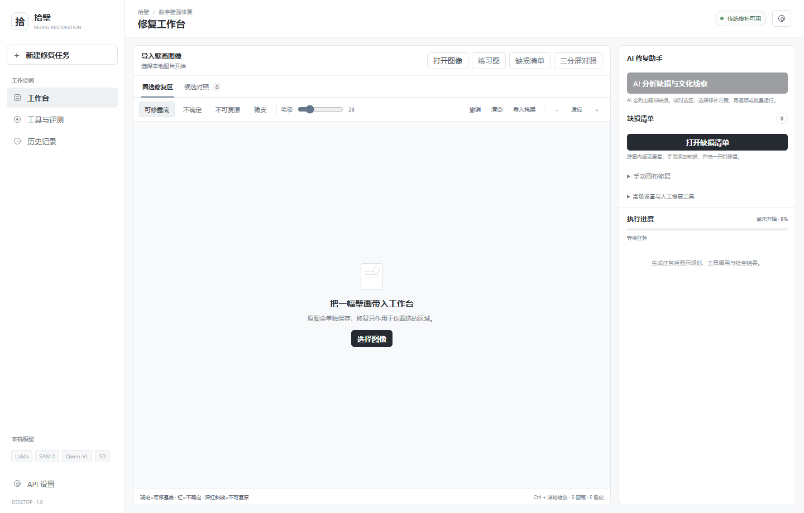

# 拾壁开发基线

## 环境与来源

| 项目 | 本机记录 |
| --- | --- |
| 验证日期 | 2026-11-16（UTC+8） |
| 仓库 | `D:\Projects\mural-restoration-agent` |
| 远端 | `https://github.com/linyinan11111-dotcom/mural-restoration-agent.git` |
| 基线提交 | `0eb05eb037453162f3702a007f81ec5fee3ff68a`，来自 `main` |
| 开发分支 | `feat/campus-mvp-deepseek` |
| 系统 | Windows 11 x64，构建 `10.0.26200` |
| Python | CPython 3.13.5 x64（`E:\python\python.exe`），项目运行于根目录 `.venv` |
| Git | `2.55.0.windows.3` |
| pip / Node.js | `25.1.1` / `v24.18.0` |
| 可选模型及 API | 基线使用本地规则、传统修补和测试替身。未安装 `requirements-models.txt`、未下载权重、未配置或调用在线 API |

目标目录原为空，克隆后 `main` 跟踪 `origin/main`，工作树无改动，再创建开发分支。仓库的运行和开发依赖采用版本范围，下节的版本快照用于重建本机验证环境。CI 的实际配置见 [tests.yml](../.github/workflows/tests.yml)，在 Windows／Python 3.13 上分开运行有标记的 WebEngine 测试与其余测试，并做运行时导入、JavaScript 语法检查和 Python 字节编译。

## 安装、启动和运行验证

在 PowerShell 中从仓库根目录执行。以下沿用 `start.cmd` 和 README 的手动安装步骤，显式指定本机已验证的 64 位解释器。在另一台电脑上使用对应的 CPython 3.13 x64 路径。

```powershell
Set-Location 'D:\Projects\mural-restoration-agent'
& 'E:\python\python.exe' -m venv .venv
.\.venv\Scripts\python.exe -m pip install -r requirements.txt
.\.venv\Scripts\python.exe -m pip install -r requirements-dev.txt
.\start.cmd
```

带控制台的同一应用入口为 `.\.venv\Scripts\python.exe -m mural_agent.desktop`。启动脚本仅在 `.venv\Scripts\python.exe` 不存在时安装运行依赖，然后交给 `pythonw.exe`。无权重时可载入内置合成示例、手工拖框或画掩膜、用规则和 OpenCV 修补、复核候选，再保存 PNG 或导出 ZIP。默认工作区在 `data/`，包含 SQLite 工作区和图像、掩膜、候选等本地文件。

### 本机结果

| 验证 | 结果 |
| --- | --- |
| `pip install -r requirements.txt` 和 `pip install -r requirements-dev.txt` | 均以退出码 `0` 完成。安装仅运行依赖时已通过 `mural_agent.desktop` 导入检查，Qt 报告 `6.12.0`。`pip check` 无依赖冲突。 |
| `.\.venv\Scripts\python.exe -m pytest -q` | **98 通过，1 条警告，退出码 `0`，41.54 秒。** 包括真实 Qt WebEngine 外壳、OpenCV 修补和 ZIP 导出，以及使用测试替身的 Qwen 分析清单路径。警告来自 Starlette TestClient 对 `httpx` 的弃用提示。 |
| `.\.venv\Scripts\python.exe scripts/verify_desktop.py` | **失败，退出码 `1`。** 页面加载通过，示例图和掩膜已写入 `artifacts/native-verification-web/`，数据库只有图像和掩膜记录。脚本固定请求 LaMa，运行环境无 LaMa 权重及 PyTorch，任务在创建阶段被拒绝。脚本随后在轮询任务的第 87 行抛出 `StopIteration`。未运行模型推理，也没有生成该脚本预期的 CUDA 验收报告和 ZIP。通过条件需要真实 `tool=lama`、`device=cuda` 的候选。 |
| `node --check ui/app.js` 和 `.\.venv\Scripts\python.exe -m compileall -q mural_agent` | 均通过，退出码 `0`。 |

首次使用命令行默认的 Anaconda Python 3.12.3 创建虚拟环境，桌面验证在导入 `PySide6.QtWidgets` 时因 DLL 加载失败退出。随后使用本机 CPython 3.13.5 重建 `.venv`，同一组 Qt 软件包成功导入。以上测试结果来自重建后的环境。[VALIDATION.md](../VALIDATION.md) 的 76 项通过及真实 LaMa CUDA 记录属于较早的验证环境。

### 本机依赖版本

以下为本机开发虚拟环境的 `pip freeze`。如需重新安装相同版本，可将这段保存为 Git 工作区外的文本文件，用 `python -m pip install -r <文件>` 安装到新的 CPython 3.13 x64 虚拟环境。

```text
altgraph==0.17.5
annotated-doc==0.0.6
annotated-types==0.8.0
anyio==4.16.0
certifi==2026.10.23
click==8.5.1
colorama==0.4.6
fastapi==0.163.1
h11==0.16.0
httpcore==1.0.9
httpx==0.28.1
idna==3.20
ImageIO==2.38.1
iniconfig==2.3.1
lazy-loader==0.6
networkx==3.7
numpy==2.5.4
opencv-python-headless==4.14.0.94
opentelemetry-api==1.45.2
packaging==26.3
pefile==2024.8.26
pillow==12.3.0
pluggy==1.7.0
pydantic==2.14.3
pydantic_core==2.50.4
Pygments==2.21.0
pyinstaller==6.22.3
pyinstaller-hooks-contrib==2026.10
PySide6_Addons==6.12.0
PySide6_Essentials==6.12.0
PySide6_WebEngine==6.12.0.140
pytest==9.2.0
python-multipart==0.0.33
pywin32-ctypes==0.2.3
scikit-image==0.26.0
scipy==1.18.1
setuptools==84.2.1
shiboken6==6.12.0
starlette==1.10.0
tifffile==2026.11.12
typing-inspection==0.4.5
typing_extensions==4.16.0
uvicorn==0.54.0
```

## 原始桌面截图



Qt WebEngine 离屏截图，1440 × 920。使用新建的空工作区，未导入图像或执行模型任务。

## 真实桌面调用路径

以下路径和行号按基线提交记录。桌面通过 Qt WebEngine 直接加载本地界面，QWebChannel 提供 JS 到 Python 的调用。FastAPI 的 [mural_agent/app.py](../mural_agent/app.py#L62) 用于开发和回归。

| 操作 | 入口与数据流 |
| --- | --- |
| 启动 | [start.cmd](../start.cmd#L8) → [mural_agent/desktop.py](../mural_agent/desktop.py#L3) → [desktop_web.py `main`](../mural_agent/desktop_web.py#L872) → `WebMainWindow` 构建 `Store`、`Engine`，注册 QWebChannel 的 `bridge`，加载 [ui/index.html](../ui/index.html) 和 [ui/app.js](../ui/app.js#L1447)。 |
| 导入图像 | [ui/app.js `openImage`](../ui/app.js#L379) → [desktop_web.py `Bridge.openImage`](../mural_agent/desktop_web.py#L167) 弹出本地文件选择器 → [workspace.py `add_image`](../mural_agent/workspace.py#L11) 保存原始字节 `source.bin`、EXIF 校正后的 8 位 RGB 工作副本 `image.png` 及各自的 SHA-256。 |
| 本地视觉分析 | [ui/app.js 分析按钮](../ui/app.js#L1221) 传 `workflow='professional_step'` → [desktop_web.py `Bridge.autoRestore`](../mural_agent/desktop_web.py#L567) → [auto_restore.py `auto_restore`](../mural_agent/auto_restore.py#L359) → `propose_restore` / `_collect_proposals` → [damage_assessment.py `assess_image`](../mural_agent/damage_assessment.py#L139)。检查本地模型目录中的 `provenance.json`，生成最长边 1024 px 的 JPEG，再以 `python -m mural_agent.damage_assessment` 调用本机 Qwen3-VL 子进程。模型只从本地加载，超时 240 秒。输出经解析和合并，含疑似缺损类型、归一化框、置信度、可见证据及待核实文化线索。 |
| 缺损清单 | [auto_restore.py `propose_restore`](../mural_agent/auto_restore.py#L310) 准备掩膜候选、方法建议和风险信息，返回 `job=None`。细裂纹可用细线启发式，其余候选可走 SAM 或矩形回退。前端 [ui/app.js `renderDamage`](../ui/app.js#L937) 显示清单，支持定位、重新打开、指定修补方法。用户拖框或运行尚无掩膜建议的条目时，可经 [desktop_web.py `Bridge.addManualDefect`](../mural_agent/desktop_web.py#L288) 保存矩形区域。 |
| 创建任务和修复 | [ui/app.js `runDefectRepairs`](../ui/app.js#L997) → [desktop_web.py `Bridge.runDefectRepairs`](../mural_agent/desktop_web.py#L616) → [defect_jobs.py `run_confirmed_defects`](../mural_agent/defect_jobs.py#L20) 为各确认条目独立建任务，固定规则规划，普通修补默认保守，LaMa 不可用时回退 Telea。显式尝试生成需要扩散权重，进入推测模式。清单路径保留原风险记录，允许尝试各风险类。经 [workspace.py `create_job`](../mural_agent/workspace.py#L54) → [engine.py `Engine.submit` / `run`](../mural_agent/engine.py#L170) → [tools.py `ToolRegistry.execute`](../mural_agent/tools.py#L29) 生成候选，合成、检查工作掩膜外像素并进入 `review`。手工掩膜可用 `Bridge.saveMask` / `Bridge.createJob` 接入同一引擎。 |
| 人工复核 | [ui/app.js 候选对照及确认](../ui/app.js#L1235) → [desktop_web.py `Bridge.selectCandidate`](../mural_agent/desktop_web.py#L390) → [professional.py `validate_candidate_selection`](../mural_agent/professional.py#L307) 校验并写入候选 ID、决定、备注和时间。专业分步要求选择采纳、修改后采纳或驳回。推测结果须明确按假设归档。 |
| 保存与导出 | [ui/app.js 保存和导出按钮](../ui/app.js#L1272) → [desktop_web.py `Bridge.saveResult` / `exportArchive`](../mural_agent/desktop_web.py#L424) → [engine.py `Engine.export`](../mural_agent/engine.py#L336) 写 ZIP。包括原始字节、工作图、掩膜、选定候选和差异图、其他候选文件、`manifest.json`（任务、复核、依赖、版本等），按任务附带有效工作掩膜、参考证据或缺损建议。驳回候选禁止保存与导出，已标记的假设可导出 ZIP，禁止保存为修复 PNG。 |

## 能力与已知限制

- 本机无权重验证覆盖传统修补、掩膜、任务状态、候选复核和 ZIP 的回归。仓库另有参考图配准、历史及续跑、备份、数据导入与配对评测入口。真实 Qwen3-VL、SAM、LaMa CUDA、扩散和云重绘仍需各自环境与独立验收。
- 标准和专业分步工作台对风险、加强修补和复核设有门禁。缺损清单的逐项路径可尝试 `uncertain` 和 `unrestorable`，原风险信息随任务保留。真实壁画的识别、风险分类和修补质量缺少专家标注验证，数字候选仅供实验和人工复核。
- 可选视觉规划的 [config.py `Settings`](../mural_agent/config.py#L53) 和 [planner.py `api_plan`](../mural_agent/planner.py#L148) 已提供通用协议、计划校验和工具白名单。当前 `api_plan` 会向服务发送两张缩略图。DeepSeek 接入与验收计划见 [校园 MVP 开发计划](CAMPUS_MVP_PLAN.md)。
- 模型权重、API 密钥、工作区、后续下载的数据、训练输出和日志留在本地。`.gitignore` 覆盖约定的目录和常见权重、密钥和临时文件类型。`datasets/` 中已经由 Git 跟踪的公开评测样本和示例清单保持原样。脚本 `scripts/download_examples.py` 会写入这个已有样本目录，本次没有运行。
